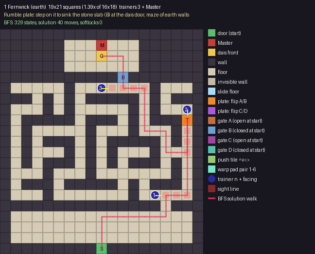
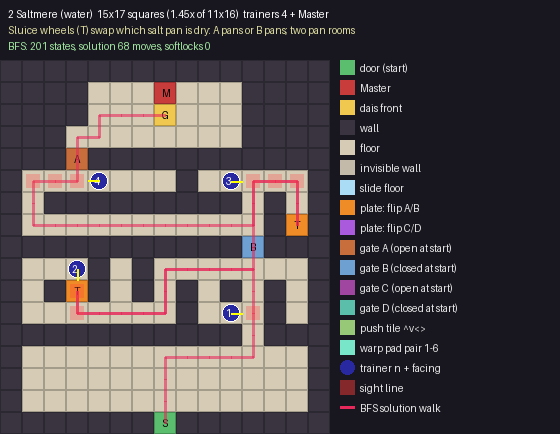
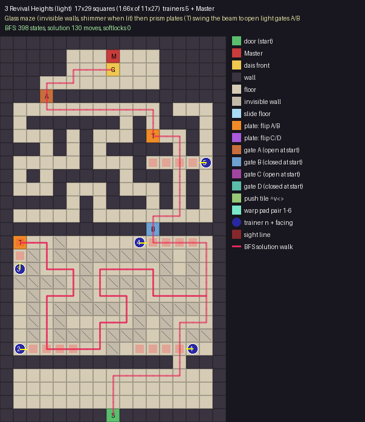
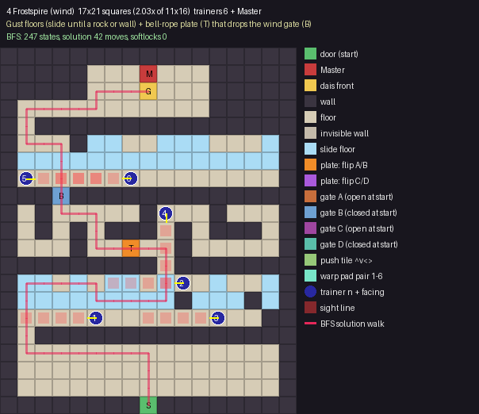
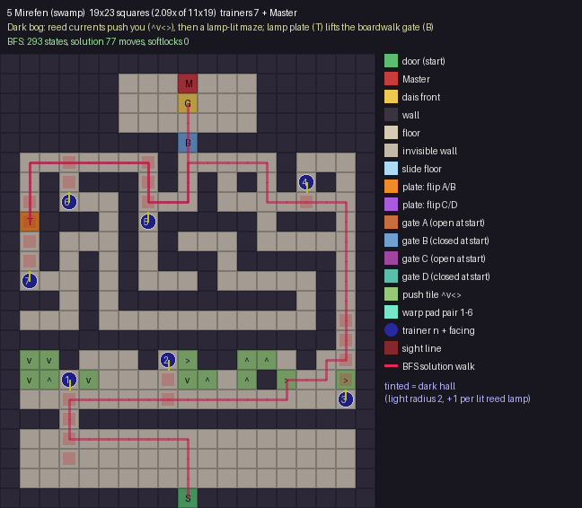
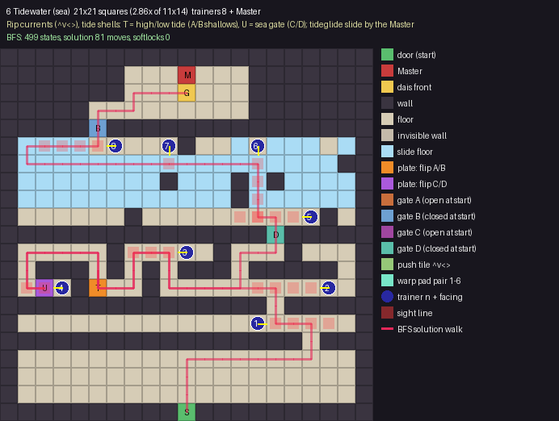
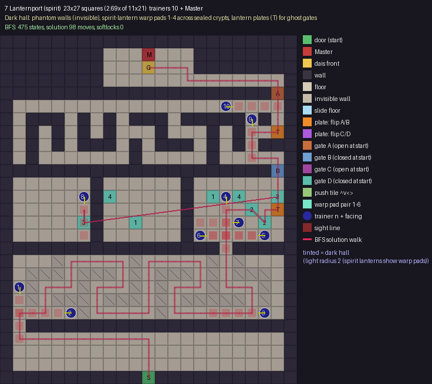
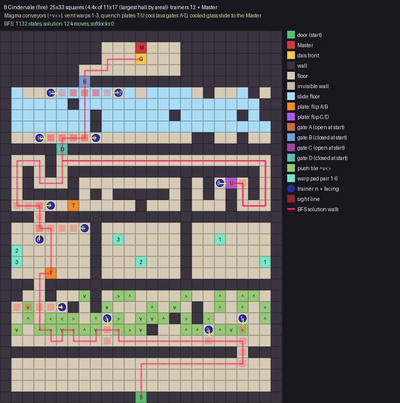

# Master's Hall interior overhaul: PHASE 1 plan (for Gary's approval)

Oct 29 2026, branch dev/hall-trainers (from 043bea1). Plan only: no maps built, nothing published, nothing pushed.

Gary's rules: size, puzzle difficulty and trainer count all go up as the halls get more renowned. Fernwick and Saltmere stay compact (1.2-1.5x), the middle halls are medium, and Lanternport and Cindervale are the largest. Trainers go from 3 to 12 (hard cap of 12, not counting the Master). The wording follows the house rules.

**Ideas taken from monster-RPG halls (ideas only, no layouts, names or art):** slide floors, push/spinner tiles, switch gates, invisible walls, warp pads, dark rooms with limited light, and trainers placed along the forced walk.

**Tools:** `tools/hall_overhaul/plan.py` (generator, BFS solver, renderer) and `run.py` (hall specs). I checked for free-licensed code first. jostbr/pymaze (MIT) has a recursive-backtracker maze, and jwang5675/Ice-Puzzle-Generator has a generate-then-BFS-verify approach but no license, so I took only the idea. The code here is original.
Output: `shots/hall_overhaul_plan/<hall>.png`, `contact_sheet.png`, and `plans.json` (full ASCII grids, seeds, trainer cells, BFS moves).

**What the solver proves:** it runs a BFS over (square, switch bits) and handles slides, push chains, warps and plate toggles. For every hall: (1) the Master's dais front (G) can be reached from the door (S). (2) Every reachable state can still reach G (no softlock). (3) Every reachable state can walk back to the door (the player can always get out). These checks are run again after each trainer is placed, with trainers counted as solid. The grid is strictly square. Corridors are one square wide, and every corridor square can be walked.

**Trainer placement:** each trainer stands off the solution walk, outside the lobby and away from the dais, at least 3 squares from any other trainer. Its sight line (up to 4 squares, red in the mockups) has to cross the solution walk. Trainers are spaced evenly along the walk, and numbers follow the order you meet them. The Master stands on the dais (M), and the hall rule stays the same: every trainer has to be beaten first.

## Summary

| # | Hall | Theme | Size (was) | Scale | Mechanic | Trainers | BFS states | Solution moves | Softlocks |
|---|---|---|---|---|---|---|---|---|---|
| 1 | Fernwick | earth | 19x21 (16x18) | 1.39x | Rumble-plate maze | 3 | 329 | 40 | 0 |
| 2 | Saltmere | water/sea | 15x17 (11x16) | 1.45x | Sluice pans, 2 rooms | 4 | 201 | 68 | 0 |
| 3 | Revival Heights | light | 17x29 (11x27) | 1.66x | Glass maze + prism gates | 5 | 398 | 130 | 0 |
| 4 | Frostspire | bird/wind | 17x21 (11x16) | 2.03x | Gust floors + bell gate | 6 | 247 | 42 | 0 |
| 5 | Mirefen | swamp | 19x23 (11x19) | 2.09x | Dark bog: currents + lamp maze | 7 | 293 | 77 | 0 |
| 6 | Tidewater | sea | 21x21 (11x14) | 2.86x | Tides, two channels | 8 | 499 | 81 | 0 |
| 7 | Lanternport | spirit/ghost | 23x27 (11x21) | 2.69x | Phantom crypts + spirit warps | 10 | 475 | 98 | 0 |
| 8 | Cindervale | fire/magma | 25x33 (11x17) | 4.41x | Forge: conveyors, vents, quench, glass slide | 12 | 1132 | 124 | 0 |

Cindervale comes out at 4.4x. Its current footprint (11x17) is small, and it has to be the biggest hall and hold 12 trainers, so I sized it for that. If you want it near 3x, a 23x27 version would drop a stage or two trainers.

## Trainer roster vs Text Bot's 22 names

| Hall | Target | Current (pre-v1) | v1 names kept | v1 names cut | Still need names + lines |
|---|---|---|---|---|---|
| Fernwick | 3 | 2 | Mabyn | Hamish, Tansy, Ferdie | 0 |
| Saltmere | 4 | 3 | Maud | Gwilym, Hettie | 0 |
| Revival Heights | 5 | 4 | Cressida | Lucan | 0 |
| Frostspire | 6 | 3 | Solveig, Torvald, Ingrid | - | 0 |
| Mirefen | 7 | 3 | Tilda, Barnaby, Imelda | - | 1 |
| Tidewater | 8 | 4 | Linnea, Fergal | - | 2 |
| Lanternport | 10 | 3 | Cosima, Ignatius (Iggy), Dulcie | - | 4 |
| Cindervale | 12 | 4 | Rasmus, Effie | - | 6 |

Total: 55 hall trainers (48 today). 6 names are cut (Hamish, Tansy, Ferdie, Gwilym, Hettie, Lucan; their lines stay in `_meta.pending_hall_trainers` in case they are wanted later). **13 new trainers need names and lines**: Mirefen 1, Tidewater 2, Lanternport 4, Cindervale 6. As planned, Fernwick keeps its 2 current trainers plus Mabyn, Saltmere keeps 3 plus Maud, and Revival keeps 4 plus Cressida.

## 1. Fernwick (earth): 19x21, 3 trainers + Master



- **Mechanic and theme fit:** Earth walls form a one-wide maze; one rumble plate (T) sinks the stone slab (gate B) at the dais door. Stepping on it again raises the slab, so the player can never trap themselves.
- **Code reuse:** Reuse the Fernwick plates runtime (src/systems/puzzles.js); add a gate cell bound to the plate.
- **Solution path:** the BFS shortest walk is 40 moves (`UUURRRRRRUURRUUUUUUUDDDLLUULLUUUULLUUULL`). It is drawn in pink on the mockup. The 329 reachable states have 0 softlocks and every one can get back to the door.
- **Start / Master:** door S at (9, 20). The Master is at (9, 1) on a 7x3 dais (rows 1-3), and you reach the front square G from below.
- **Roster:** Mabyn kept from v1; 0 new needed.
- **Trainers (x,y, facing, sight squares, solution step first seen):**
  - T1 at (14, 15) facing R, sight 3, meets the path at step ~11
  - T2 at (17, 7) facing D, sight 4, meets the path at step ~17
  - T3 at (9, 5) facing R, sight 4, meets the path at step ~33

```
###################
######...M...######
######...G...######
######.......######
###########b#######
#.....#.......#...#
###.#.#.#####.#.###
#...#.#.....#.#...#
#.#####.###.#.###T#
#.#.....#...#...#.#
#.#.###.#.#####.#.#
#.#...#.#.#...#...#
#.#.###.#.#.###.#.#
#...#...#.......#.#
#.###.#####.#.###.#
#...#.......#.....#
###############.###
#.................#
#.................#
#.................#
#########S#########
```

## 2. Saltmere (water/sea): 15x17, 4 trainers + Master



- **Mechanic and theme fit:** Each sluice wheel (T) swaps which pans are dry (A or B). Room 1's exit is a B pan, room 2's exit is an A pan, so the player has to work the wheel in each room.
- **Code reuse:** Extends KINDS.sluice: heights 0/1 map to gate states A/B.
- **Solution path:** the BFS shortest walk is 68 moves (`UUURRRRUUUULLLLDDLLLLUDRRRRUURRRRUUUURRDDUULLDDLLLLLLLLLLUURRUURURRR`). It is drawn in pink on the mockup. The 201 reachable states have 0 softlocks and every one can get back to the door.
- **Start / Master:** door S at (7, 16). The Master is at (7, 1) on a 7x3 dais (rows 1-3), and you reach the front square G from below.
- **Roster:** Maud kept from v1; 0 new needed.
- **Trainers (x,y, facing, sight squares, solution step first seen):**
  - T1 at (10, 11) facing R, sight 1, meets the path at step ~9
  - T2 at (3, 9) facing D, sight 2, meets the path at step ~21
  - T3 at (10, 5) facing R, sight 3, meets the path at step ~37
  - T4 at (4, 5) facing L, sight 3, meets the path at step ~59

```
###############
####...M...####
####...G...####
###........####
###a###########
#.......#.....#
#.#########.#.#
#...........#T#
###########b###
#...#.#.......#
#.#T#.#.#.#.#.#
#.......#...#.#
###########.###
#.............#
#.............#
#.............#
#######S#######
```

## 3. Revival Heights (light): 17x29, 5 trainers + Master



- **Mechanic and theme fit:** Lower room: glass walls that are invisible (they shimmer only once you bump them or the room is lit), laid out as a maze. Upper room: prism plates (T) swing the beam to open light gate B and then light gate A.
- **Code reuse:** KINDS.prism handles the gates; a new invisible-wall cell flag is needed (collision on, art off).
- **Solution path:** the BFS shortest walk is 130 moves (`UUURRRRRUUUURRUULLLLUULLLLDDRRDDLLDDLLLLUUUURRUULLUULLRRDDRRDDLLDDDDRRRRUURRUULLUURRRRDDRRRRUUUULLLLUURRUUUUUULLUULLLLLLLLUURRURRR`). It is drawn in pink on the mockup. The 398 reachable states have 0 softlocks and every one can get back to the door.
- **Start / Master:** door S at (8, 28). The Master is at (8, 1) on a 7x3 dais (rows 1-3), and you reach the front square G from below.
- **Roster:** Cressida kept from v1; 0 new needed.
- **Trainers (x,y, facing, sight squares, solution step first seen):**
  - T1 at (14, 23) facing L, sight 4, meets the path at step ~10
  - T2 at (1, 23) facing R, sight 4, meets the path at step ~38
  - T3 at (1, 17) facing U, sight 2, meets the path at step ~54
  - T4 at (10, 15) facing R, sight 4, meets the path at step ~97
  - T5 at (15, 9) facing L, sight 4, meets the path at step ~108

```
#################
#####...M...#####
#####...G...#####
###.........#####
###a#############
#...........#...#
#.#######.#.###.#
#...#.#...#T..#.#
###.#.#.#####.#.#
#.....#...#.....#
#.#.#####.###.#.#
#...#...#...#.#.#
#####.#.###.#.#.#
#.....#.........#
###########b#####
#T..x...........#
#.x.xxxxxxxxx.x.#
#.x...x.....x.x.#
#xxxx.x.xxx.xxx.#
#.x...x...x.....#
#.x.xxxxx.xxxxx.#
#.x.x.....x.x...#
#.x.xxx.xxx.x.xx#
#.......x.......#
#############.###
#...............#
#...............#
#...............#
########S########
```

## 4. Frostspire (bird/wind): 17x21, 6 trainers + Master



- **Mechanic and theme fit:** Two gust-floor rooms: you slide until a rock or wall stops you, so you plan each stop. A maze in between holds the bell-rope plate (T) that drops the wind gate (B).
- **Code reuse:** Reuses the gust runtime and the dev/region4-station ice floor; gust slide = "i" cells.
- **Solution path:** the BFS shortest walk is 42 moves (`UUULLLLLLLUUURRDRUULLLLUULLUUULLUURRRRURRR`). It is drawn in pink on the mockup. The 247 reachable states have 0 softlocks and every one can get back to the door.
- **Start / Master:** door S at (8, 20). The Master is at (8, 1) on a 7x3 dais (rows 1-3), and you reach the front square G from below.
- **Roster:** Solveig, Torvald, Ingrid kept from v1; 0 new needed.
- **Trainers (x,y, facing, sight squares, solution step first seen):**
  - T1 at (5, 15) facing L, sight 4, meets the path at step ~12
  - T2 at (10, 13) facing L, sight 4, meets the path at step ~19
  - T3 at (12, 15) facing L, sight 4, meets the path at step ~23
  - T4 at (9, 9) facing D, sight 4, meets the path at step ~26
  - T5 at (1, 7) facing R, sight 4, meets the path at step ~38
  - T6 at (7, 7) facing L, sight 4, meets the path at step ~38

```
#################
#####...M...#####
#####...G...#####
#...........#####
#.###############
#...#ii..iii...i#
#iiiiiiiiiiiiiii#
#...............#
###b#############
#.#.....#...#...#
#.#.#.###.#.###.#
#...#..T..#.....#
#########.#######
#ii.i.ii.i..i..i#
#iiiiiiiii#iii#i#
#..............##
#.###############
#...............#
#...............#
#...............#
########S########
```

## 5. Mirefen (swamp): 19x23, 7 trainers + Master



- **Mechanic and theme fit:** Reed currents (push tiles ^v<>) carry you across the first bog. The upper room is dark (light radius 2, +1 per lit reed lamp, from the existing hall_lamps darkness). The lamp plate (T) lifts the boardwalk gate (B).
- **Code reuse:** Reuses hall_lamps.js darkness/tint and KINDS.boardwalk; push tiles are new.
- **Solution path:** the BFS shortest walk is 77 moves (`UUULLLLLLUURRRRRRRRRRRURURUUUUUUUULLLLUULLLLDDLLUULLLLLLDDDUUURRRRRRDDRRUUUUU`). It is drawn in pink on the mockup. The 293 reachable states have 0 softlocks and every one can get back to the door.
- **Start / Master:** door S at (9, 22). The Master is at (9, 1) on a 7x3 dais (rows 1-3), and you reach the front square G from below.
- **Roster:** Tilda, Barnaby, Imelda kept from v1; 1 new needed.
- **Trainers (x,y, facing, sight squares, solution step first seen):**
  - T1 at (3, 16) facing D, sight 4, meets the path at step ~9
  - T2 at (8, 15) facing D, sight 2, meets the path at step ~16
  - T3 at (17, 17) facing U, sight 4, meets the path at step ~27
  - T4 at (15, 6) facing D, sight 1, meets the path at step ~37
  - T5 at (7, 8) facing U, sight 3, meets the path at step ~49
  - T6 at (3, 7) facing U, sight 2, meets the path at step ~55
  - T7 at (1, 11) facing U, sight 4, meets the path at step ~59

```
###################
######...M...######
######...G...######
######.......######
#########b#########
#.......#.....#...#
#.#.###.#.#.#.#.#.#
#.#...#...#.......#
#T###.#.#####.###.#
#.#...#.#...#.....#
#.#.#.#.###.#####.#
#...#.#...#.....#.#
###.#.#########.#.#
#...#...........#.#
#################.#
#vv#...#.>##^^.#..#
#v^.v....v^.^#>..>#
#.................#
###.###############
#.................#
#.................#
#.................#
#########S#########
```

## 6. Tidewater (sea): 21x21, 8 trainers + Master



- **Mechanic and theme fit:** Rip currents (push tiles) at the entry. The middle maze has two shells: T switches high/low tide (shallows A/B) and U opens the sea gate (C/D); you need both. A tideglide slide leads to the dais.
- **Code reuse:** Extends KINDS.tide (stop H/O) to two bits; glide lanes = slide cells.
- **Solution path:** the BFS shortest walk is 81 moves (`UUURRRRRRRUULLUULLLLLLUULLDDLLUULLLLDDRLUURRRRDDUDRRUURRDDRRRRUURRUULULURUURRURRR`). It is drawn in pink on the mockup. The 499 reachable states have 0 softlocks and every one can get back to the door.
- **Start / Master:** door S at (10, 20). The Master is at (10, 1) on a 7x3 dais (rows 1-3), and you reach the front square G from below.
- **Roster:** Linnea, Fergal kept from v1; 2 new needed.
- **Trainers (x,y, facing, sight squares, solution step first seen):**
  - T1 at (14, 15) facing R, sight 4, meets the path at step ~12
  - T2 at (18, 13) facing L, sight 4, meets the path at step ~16
  - T3 at (10, 11) facing L, sight 3, meets the path at step ~24
  - T4 at (3, 13) facing L, sight 2, meets the path at step ~38
  - T5 at (17, 9) facing L, sight 4, meets the path at step ~68
  - T6 at (14, 5) facing D, sight 4, meets the path at step ~69
  - T7 at (9, 5) facing D, sight 1, meets the path at step ~77
  - T8 at (6, 5) facing L, sight 4, meets the path at step ~87

```
#####################
#######...M...#######
#######...G...#######
#####.........#######
#####b###############
#iiii.....#..i.iii.i#
#iiiiiiiiiiiiiiiiii##
#iiiiiiii#iii#i#iiii#
#iiiiiiiiiiii#iiiiii#
#......#..........#.#
###############d#####
#.....#.....#...#...#
#.###.#.#.###.#####.#
#.U.#T..#...........#
###############.#####
#...................#
#################.###
#...................#
#...................#
#...................#
##########S##########
```

## 7. Lanternport (spirit/ghost): 23x27, 10 trainers + Master



- **Mechanic and theme fit:** A dark hall (light radius 2, spirit lanterns show the warp pads). Lower crypt: phantom (invisible) walls. Middle: three sealed crypts joined only by paired warp pads 1-4, some of which are decoys. Top: lantern plates (T) for the ghost gates.
- **Code reuse:** KINDS.lens lamp-order rooms can drive the gate plates; warp pads are new (a pair table in the def).
- **Solution path:** the BFS shortest walk is 98 moves (`UUULLLLLLLLLLUURRUURRUURRRRDDLLDDRRRRUUUURRRRDDLLDDRRRRRRUULLUUUUUURRURUUDUUULLUURRUUUULLLLLLLULLL`). It is drawn in pink on the mockup. The 475 reachable states have 0 softlocks and every one can get back to the door.
- **Start / Master:** door S at (11, 26). The Master is at (11, 1) on a 7x3 dais (rows 1-3), and you reach the front square G from below.
- **Roster:** Cosima, Ignatius (Iggy), Dulcie kept from v1; 4 new needed.
- **Trainers (x,y, facing, sight squares, solution step first seen):**
  - T1 at (1, 19) facing D, sight 4, meets the path at step ~13
  - T2 at (5, 21) facing L, sight 4, meets the path at step ~15
  - T3 at (20, 21) facing L, sight 4, meets the path at step ~54
  - T4 at (17, 12) facing D, sight 4, meets the path at step ~64
  - T5 at (20, 15) facing L, sight 4, meets the path at step ~65
  - T6 at (15, 15) facing R, sight 4, meets the path at step ~65
  - T7 at (18, 14) facing L, sight 3, meets the path at step ~66
  - T8 at (6, 12) facing D, sight 3, meets the path at step ~74
  - T9 at (19, 6) facing D, sight 3, meets the path at step ~82
  - T10 at (17, 5) facing R, sight 4, meets the path at step ~88

```
#######################
########...M...########
########...G...########
########..............#
#####################a#
#.....................#
#.###.#.#.###.#####.#.#
#.#.#.#.#...#...#.#..T#
#.#.#.###.#.###.#.#.###
#.#.......#.....#.....#
#####################b#
#......#......#.......#
#......#4.....#.1.4..3#
#......#......#....2.T#
#.....3#..1...#.....2.#
#......#......#.......#
#################.#####
#...x.....x.....x.x...#
#.xxx.xxx.x.xxx.x.xxx.#
#.x...x...x.x...x...x.#
#.x.xxx.xxx.x.xxxxx.x.#
#.....x.....x.........#
#.#####################
#.....................#
#.....................#
#.....................#
###########S###########
```

## 8. Cindervale (fire/magma): 25x33, 12 trainers + Master



- **Mechanic and theme fit:** Magma conveyors (push tiles), vent warps 1-3 across walled chambers, a maze with two quench plates (T/U) that cool lava gates A-D, then a cooled-glass slide up to the Master.
- **Code reuse:** Extends KINDS.quench (cool = gate open) to two channels; reuses the slide and warp cells from the halls above.
- **Solution path:** the BFS shortest walk is 124 moves (`UUURRRRRRRRRUULLLLLLLLLLLULLLULUUUUURUUUULUULLUUUURRDDRRUURRRRRRRRRRRRRRRRRRDDDDLLUULRDDRRUUUULLLLLLLLLLLLLLLLLLUURRUURRURRR`). It is drawn in pink on the mockup. The 1132 reachable states have 0 softlocks and every one can get back to the door.
- **Start / Master:** door S at (12, 32). The Master is at (12, 1) on a 7x3 dais (rows 1-3), and you reach the front square G from below.
- **Roster:** Rasmus, Effie kept from v1; 6 new needed.
- **Trainers (x,y, facing, sight squares, solution step first seen):**
  - T1 at (21, 25) facing D, sight 4, meets the path at step ~12
  - T2 at (18, 26) facing D, sight 1, meets the path at step ~17
  - T3 at (9, 25) facing D, sight 2, meets the path at step ~27
  - T4 at (5, 24) facing L, sight 4, meets the path at step ~39
  - T5 at (7, 17) facing L, sight 4, meets the path at step ~47
  - T6 at (3, 18) facing U, sight 3, meets the path at step ~48
  - T7 at (4, 15) facing L, sight 3, meets the path at step ~50
  - T8 at (19, 13) facing R, sight 2, meets the path at step ~90
  - T9 at (8, 9) facing L, sight 4, meets the path at step ~120
  - T10 at (3, 9) facing R, sight 4, meets the path at step ~120
  - T11 at (4, 5) facing R, sight 4, meets the path at step ~126
  - T12 at (10, 5) facing L, sight 4, meets the path at step ~126

```
#########################
#########...M...#########
#########...G...#########
#######.........#########
#######b#################
#i...iiiii.i.iiii.#..i#.#
#iiiii#iiiiiiiiiiiiiiii##
#iiiiiii#iiiiii#iiiii#i##
#iiiiiii#iiiiiiiiiiiiiii#
#................##..#..#
#####d###################
#...#...................#
#.#.#.#################.#
#.#...#.........#.#.U.#.#
#.#####.#.#####.#.#.#.#.#
#.....T.....#...#...#...#
###.#####################
#.......#.......#.......#
#.......#.3.....#..1....#
#2......#.......#.......#
#3......#...2...#......1#
#...T...#.......#.......#
###.#####################
##..#..v#.>^....>..^.^^.#
#.v...#.#v...^.v.#.^.^.>#
#.^.<<>.^.>.vv^#>#<....^#
#v.^<v<^v.<>v#..^^.^v>..#
#.......................#
#####################.###
#.......................#
#.......................#
#.......................#
############S############
```

## Phase 2 (after approval)
- Build `<hall>_hall_int.json` from the approved grids (tile art from World Design), add the new cell kinds (push, warp, invisible, 2-bit gates) to src/progression/puzzles.js, and extend tests/progression.test.mjs with the same BFS proofs.
- Hand-tune the mockup layouts. They are generated (seeded) drafts, so a hall can be re-rolled or edited and re-proved with `python3 tools/hall_overhaul/run.py <hall>`.